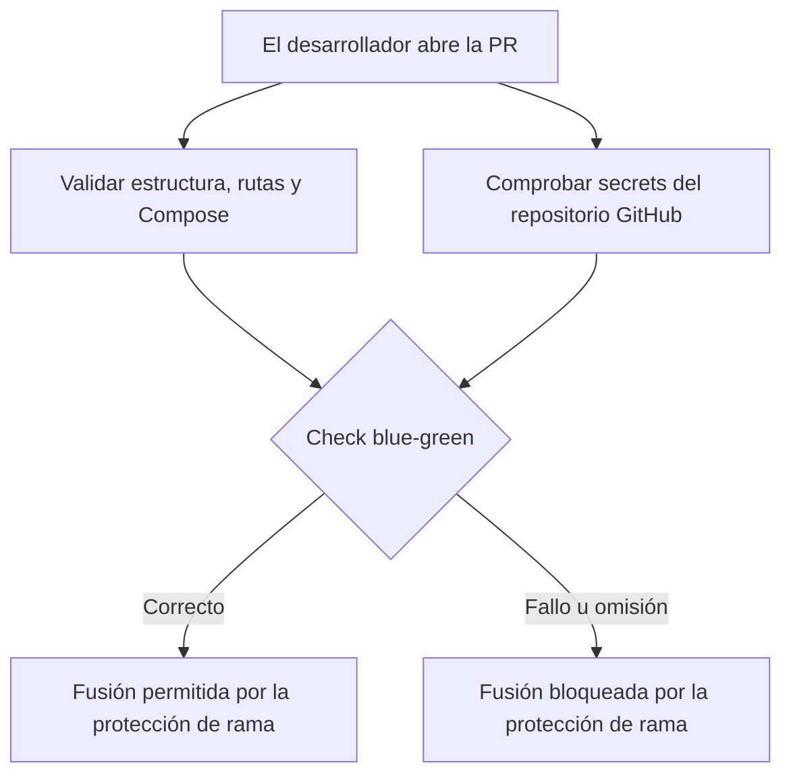
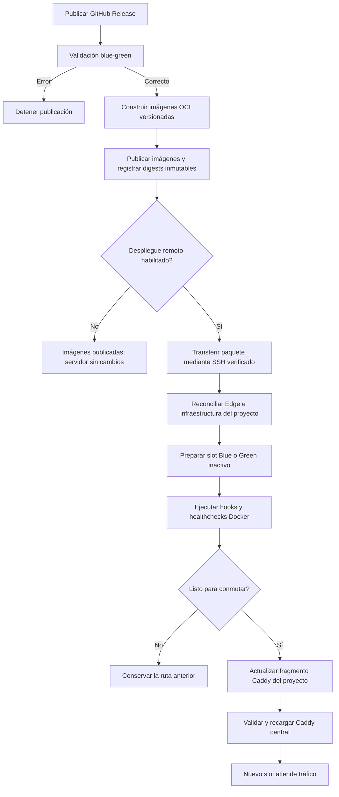

# Integración en proyectos y ciclo de despliegue

[README principal](../README.md) · [English](README.md) · **Español** · [Ciclo de secretos](secrets.es.md) · [Edge compartido](../edge/README.md)

Esta guía describe el flujo **implementado** para incorporar una aplicación Docker Compose a `docker-blue-green`: inicialización, validación en CI, publicación de imágenes OCI, despliegue remoto opcional, conmutación de rutas en Edge y rollback. Que una PR pase las comprobaciones de GitHub Actions **no demuestra** que los contenedores hayan arrancado ni que el despliegue de producción funcione.

## 1. Requisitos y responsabilidades

El desarrollador necesita Go 1.23 o posterior, Docker Engine con Compose v2, un repositorio de aplicación y su definición Compose. El repositorio declara sus servicios, infraestructura persistente y rutas públicas. `docker-blue-green` genera el contrato y los workflows; en el servidor administra **una única instalación compartida de Edge/Caddy** para todos los proyectos.

La validación de una PR no configura el servidor Docker ni instala OpenBao. Si el host ya utiliza un Caddy ajeno que ocupa 80/443, hay que migrar su propiedad y sus rutas de forma controlada: el motor no lo adopta automáticamente.

## 2. Inicializar una aplicación existente

Ejemplo de Compose original con una API y PostgreSQL:

```yaml
services:
  api:
    build: .
    ports:
      - "8080:8080"
  postgres:
    image: postgres:17
    volumes:
      - postgres_data:/var/lib/postgresql/data

volumes:
  postgres_data:
```

Instalamos una revisión fija del motor y ejecutamos el inicializador desde la raíz del repositorio:

```bash
go install github.com/jmeiracorbal/docker-blue-green/cmd/bluegreen@3815eb98b814c1093bc12ad0f53b6e9b8ce80d35
bluegreen init
```

El CLI descubre el Compose y solicita clasificar los servicios. En este ejemplo, `api` es aplicación versionada y `postgres` es infraestructura persistente. En modo no interactivo:

```bash
bluegreen init --dir . --app api --infrastructure postgres
```

Archivos generados:

```text
deploy/
├── bluegreen.yml
├── compose.yml
└── infrastructure/
    └── compose.yml
.github/
├── blue-green.env
└── workflows/
    ├── blue-green.yml
    └── release.yml
.env.example
```

`infrastructure/compose.yml` solo aparece cuando existen servicios persistentes. El código fuente y el Compose original no se reescriben. El inicializador **no arranca contenedores** y rechaza sobrescribir archivos generados que hayan sido personalizados.

## 3. Configurar el contrato declarativo

El desarrollador completa la configuración guiada:

```bash
bluegreen configure
bluegreen config check
bluegreen secrets plan
```

La misma configuración admite parámetros explícitos:

```bash
bluegreen configure \
  --project miapi \
  --host api.example.com \
  --service api \
  --port 8080 \
  --registry-host ghcr.io \
  --registry-repository empresa/miapi \
  --registry-username empresa
```

La identidad del proyecto, el registro OCI, los hooks, el destino SSH opcional y las referencias de OpenBao se guardan en `deploy/bluegreen.yml`. Las rutas públicas se declaran **únicamente** en `deploy/compose.yml` mediante `x-bluegreen.ingress`:

```yaml
x-bluegreen:
  ingress:
    - host: api.example.com
      service: api
      port: 8080
```

El Compose generado conecta la API a `DEPLOY_NETWORK`, una red Docker externa, mediante un alias dependiente del slot (`${PROJECT_NAME}-${DEPLOYMENT_SLOT}-api`). Un servicio persistente expuesto expresamente debe declarar `shared: true` y su alias de infraestructura estable. Las bases de datos y colas **no se exponen automáticamente**.

Para el despliegue SSH se utilizan los parámetros `--deploy-host`, `--deploy-user`, `--deploy-port` y `--deploy-known-hosts` de `bluegreen configure`. La clave de `known_hosts` es la **clave pública** SSH del servidor verificada previamente; la clave privada no se añade al repositorio.

## 4. Preparar GitHub y los secrets del repositorio

`bluegreen init` genera automáticamente los workflows `.github/workflows/blue-green.yml` y `.github/workflows/release.yml`, además de `.github/blue-green.env` con **valores ficticios que no son credenciales**. Estos archivos se revisan y versionan junto con el contrato.

Si está habilitado el despliegue remoto, deben existir los siguientes **secrets del repositorio GitHub**, configurados en *Settings → Secrets and variables → Actions*:

| Secret | Función |
| --- | --- |
| `SERVER_SSH_PRIVATE_KEY` | Identidad SSH del servidor de destino |
| `OCI_REGISTRY_PULL_USERNAME` | Usuario con permisos de lectura del registro OCI |
| `OCI_REGISTRY_PULL_TOKEN` | Token de lectura del registro OCI |

El control generado actualmente exige los tres cuando el despliegue remoto está activado. `GITHUB_TOKEN` es automático de GitHub para publicar en GHCR: **no hay que crearlo manualmente**. La validación comprueba que los secrets tienen contenido, no que las credenciales puedan autenticarse realmente.

Para bloquear una fusión por un error, el responsable del repositorio debe configurar en *Settings → Rules → Rulesets* (o en la protección de rama) el check **`blue-green` como obligatorio**. Crear el YAML, por sí solo, no activa la protección.

**OpenBao es independiente de los secrets de GitHub.** En la PR se validan las referencias declaradas, pero no se leen ni siembran valores KV reales. La disponibilidad de estos se comprueba en el servidor confiable con `bluegreen secrets check`.

### Secretos de aplicación opcionales mediante OpenBao

OpenBao no es un requisito para integrar ni desplegar el proyecto. Si la aplicación necesita credenciales centralizadas, el desarrollador declara referencias mediante `bluegreen secrets add`; el administrador del servidor provisiona los valores KV reales, el AppRole restringido y el proxy. El [ciclo de vida de los secretos](secrets.es.md) explica los comandos, responsables, comprobaciones, archivos de solo lectura en contenedores, rotación y rollback. Los secrets del repositorio GitHub pertenecen al proceso CI/CD y se gestionan por separado.

### Selección de runners para workflows reutilizables

Los workflows reutilizables `publish-images.yml`, `deploy-remote.yml` y `validate-consumer.yml` aceptan `runner_labels_json`, un array JSON de etiquetas del runner de GitHub Actions. El valor predeterminado es `["ubuntu-latest"]`, por lo que los consumidores existentes no cambian. Para utilizar un runner propio, pasar el parámetro en **cada** llamada:

```yaml
with:
  runner_labels_json: '["self-hosted","linux","x64","ovh"]'
```

Este parámetro selecciona el runner de todos los jobs dentro del workflow invocado. Los jobs definidos localmente por el proyecto consumidor deben configurar también su propio `runs-on`. Un JSON incorrecto provoca un error, sin cambiar silenciosamente de runner. En runners propios solo debe ejecutarse código de confianza y deben estar disponibles Go, Docker Compose, Git, SSH y las herramientas necesarias para construir imágenes OCI.

## 5. Qué ocurre al abrir una pull request



La validación reutilizable comprueba los archivos exigidos, `bluegreen.yml`, las rutas `x-bluegreen.ingress`, la exportación del contrato, la estructura de las referencias OpenBao y los Compose de aplicación e infraestructura si existen. El job independiente `repository-secrets` recibe de GitHub solo **booleanos de presencia**, nunca los valores secretos. El job final `blue-green` falla si cualquiera de los dos controles falla o se omite.

GitHub no entrega secretos del repositorio a las PR procedentes de forks. Por eso, un proyecto con despliegue remoto habilitado falla de forma cerrada en ese escenario. No se deben sustituir las credenciales reales por valores ficticios de producción.

**Una PR en verde valida el contrato y los manifiestos, pero no ejecuta los healthchecks reales de los contenedores.**

## 6. Release, publicación y despliegue opcional

Una vez fusionados los cambios, al publicar una **GitHub Release** se ejecuta el workflow generado `release.yml`. Primero ejecuta el mismo control local `blue-green`; si falla, no publica imágenes.



El workflow construye los servicios que incluyen una definición `build` en Compose, publica las imágenes versionadas y registra sus referencias por digest. Si se habilita el destino remoto, transfiere el paquete y el CLI mediante SSH y ejecuta el despliegue con la configuración declarativa.

En el servidor, la reconciliación de Edge es idempotente. Cada aplicación administra únicamente su fragmento `apps/<proyecto>.caddy`. El cambio de tráfico se realiza tras superar las operaciones del ciclo de vida y los healthchecks del slot inactivo. Si falla la publicación de rutas, el motor intenta restaurar la configuración anterior. Los servicios persistentes no se recrean al cambiar de slot.

**Requisitos en el servidor:** Docker/Compose, Edge compartido compatible, `.env` local sin secretos, acceso al registro OCI, healthchecks, volúmenes persistentes y, si corresponde, acceso limitado a OpenBao y entrega de secretos. Las comprobaciones de CI no instalan esa infraestructura ni migran un proxy existente.

## 7. Rollback y límites

El slot anterior se conserva para poder restaurar sus rutas mediante una operación controlada:

```bash
bluegreen rollback --dir . --project miapi --env-file .env
```

Este comando se ejecuta en el servidor autorizado, no en el validador de PR. El rollback conmuta las rutas de la aplicación: **no revierte migraciones de base de datos**, efectos en servicios externos, escrituras en volúmenes persistentes ni rotaciones de OpenBao. El esquema de la base de datos debe mantener compatibilidad temporal entre ambos slots.

`bluegreen config check` valida el contrato local y `bluegreen secrets plan` enumera los requisitos no sensibles. La autenticación SSH, los valores reales OpenBao, las redes, TLS y la migración de producción requieren comprobaciones específicas del entorno de destino.

## Referencias

- [README principal](../README.md)
- [Ciclo de secretos (GitHub y OpenBao opcional)](secrets.es.md)
- [Arquitectura de Edge compartido](../edge/README.md)
- [Proyecto de pruebas end-to-end](../examples/remote-e2e/README.md)
- [Workflow reutilizable de validación](../.github/workflows/validate-consumer.yml)
- [Tests de generación y CLI](../.github/workflows/test-cli.yml)
- [Documentación en inglés](README.md)
