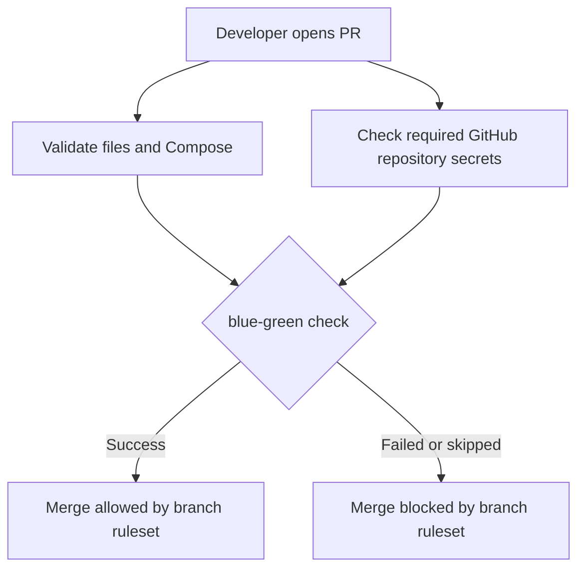
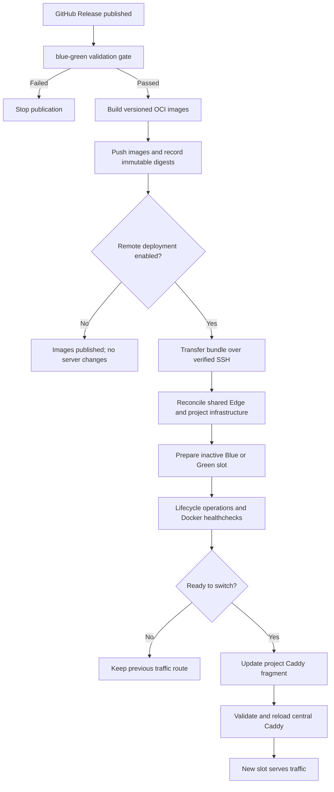

# Project integration and deployment lifecycle

[Main README](../README.md) · **English** · [Español](README.es.md) · [Secrets lifecycle](secrets.md) · [Shared Edge](../edge/README.md)

This guide describes the **implemented** integration flow for a Docker Compose application, from its first `bluegreen init` through CI, OCI image publication, optional SSH deployment, Edge route switching and rollback. GitHub Actions validation does **not** itself deploy containers or prove production health.

## 1. Preconditions and ownership

The developer needs Go 1.23 or newer, Docker Engine with Compose v2, an existing application repository and a Docker Compose definition. The repository owns its application, long-lived infrastructure and declarative ingress. `docker-blue-green` owns the generated deployment contract and workflows; on the destination Docker host it manages a **single shared Edge/Caddy** installation for all projects.

Docker host configuration, TLS state and any OpenBao installation are not created by a pull-request validation. If a different Caddy instance already owns ports 80/443, it requires a controlled handover; the engine does not silently adopt it.

## 2. Initialize an existing application

Example initial Compose definition (application and persistent database):

```yaml
services:
  api:
    build: .
    ports:
      - "8080:8080"
  postgres:
    image: postgres:17
    volumes:
      - postgres_data:/var/lib/postgresql/data

volumes:
  postgres_data:
```

Install the pinned engine, then initialize the repository:

```bash
go install github.com/jmeiracorbal/docker-blue-green/cmd/bluegreen@3815eb98b814c1093bc12ad0f53b6e9b8ce80d35
bluegreen init
```

`bluegreen init` discovers the existing Compose file and asks whether each service belongs to the versioned application or persistent infrastructure. In this example, classify `api` as application and `postgres` as infrastructure. For automated initialization:

```bash
bluegreen init --dir . --app api --infrastructure postgres
```

The initializer generates:

```text
deploy/
├── bluegreen.yml
├── compose.yml
└── infrastructure/
    └── compose.yml
.github/
├── blue-green.env
└── workflows/
    ├── blue-green.yml
    └── release.yml
.env.example
```

The `infrastructure/compose.yml` file is omitted when there are no persistent services. The original application source and its Compose definition remain separate; the initializer does not start containers and refuses to overwrite generated files that have been customized.

## 3. Configure the declarative contract

Complete the guided configuration:

```bash
bluegreen configure
bluegreen config check
bluegreen secrets plan
```

For a non-interactive setup, the same configuration can be supplied explicitly:

```bash
bluegreen configure \
  --project myapi \
  --host api.example.com \
  --service api \
  --port 8080 \
  --registry-host ghcr.io \
  --registry-repository company/myapi \
  --registry-username company
```

The project identity, registry destination, lifecycle operations, optional SSH deployment target and OpenBao references belong to `deploy/bluegreen.yml`. Public ingress belongs **only** to the Compose extension `x-bluegreen.ingress` in `deploy/compose.yml`:

```yaml
x-bluegreen:
  ingress:
    - host: api.example.com
      service: api
      port: 8080
```

The generated application Compose attaches the exposed service to the external `DEPLOY_NETWORK` with a slot-specific alias (`${PROJECT_NAME}-${DEPLOYMENT_SLOT}-api`). An explicitly exposed persistent service uses `shared: true` and a stable infrastructure alias. Databases and queues are **not** automatically exposed.

For SSH deployment, configure the verified host, user, port and SSH `known_hosts` **public** host key using `bluegreen configure --deploy-host ... --deploy-user ... --deploy-port ... --deploy-known-hosts ...`. Do not add private keys to the repository.

## 4. Prepare GitHub Actions and branch protection

`bluegreen init` creates `.github/workflows/blue-green.yml` and `.github/workflows/release.yml` automatically. It also generates `.github/blue-green.env` with **synthetic, non-secret values** used to validate Compose in CI. Review and commit these generated files with the deployment contract.

If remote deployment is enabled, add the following **GitHub Actions repository secrets** under *Settings → Secrets and variables → Actions*:

| Name | Purpose |
| --- | --- |
| `SERVER_SSH_PRIVATE_KEY` | SSH identity for the destination server |
| `OCI_REGISTRY_PULL_USERNAME` | OCI registry reader identity |
| `OCI_REGISTRY_PULL_TOKEN` | OCI registry read token |

The current generated gate requires all three when remote deployment is enabled. `GITHUB_TOKEN` is provided automatically by GitHub for GHCR publishing; it is **not** a manually created repository secret. The validation verifies **presence**, not whether SSH authentication or registry authorization will succeed.

To actually prevent merging when checks fail, configure a GitHub branch ruleset / branch protection for the default branch and require the status check named **`blue-green`**. Generating the YAML alone does not change branch protection.

`OpenBao` is separate: PR validation checks the *declared references* but never reads or provisions real KV values. Live OpenBao availability is checked in the trusted deployment environment using `bluegreen secrets check`.

### Optional OpenBao application secrets

OpenBao is not required by the integration or deployment process. When an application needs centrally managed credentials, the developer declares references with `bluegreen secrets add` and the server administrator provisions the actual KV values, project-scoped AppRole and proxy. See the complete [secrets lifecycle](secrets.md) for exact commands, roles, presence checks, read-only container delivery, rotation and rollback. GitHub repository secrets are a separate CI/CD concern.

### CI runner selection in the project contract

Runner labels belong to the single `deploy/bluegreen.yml` configuration, not to a specific application or CI provider:

```yaml
ci:
  runner_labels:
    - self-hosted
    - linux
    - x64
    - build
```

For automation, `bluegreen configure --ci-runner-labels self-hosted,linux,x64,build` persists the same setting. `bluegreen config check` rejects empty, malformed and duplicate labels; `bluegreen config export` exposes the non-secret CI selection. When `ci` is absent, the currently generated workflows retain their existing runner behavior.

The reusable workflows already accept the transport input `runner_labels_json` as a JSON array, with a default of `["ubuntu-latest"]`. **The generated caller workflows do not yet derive that input (or their local `runs-on`) from the project contract.** That generation/update integration is a separate pending stage. Do not assume configuring labels alone changes the runner used by existing generated workflows.

Only trusted application code should execute on persistent self-hosted runners; the runner must provide Go, Docker Compose, Git, SSH and OCI build tooling.

## 5. What happens on a pull request?



The reusable validation checks the expected files, the `bluegreen.yml` contract, `x-bluegreen.ingress`, exported route declarations, OpenBao reference structure, and both application/infrastructure Compose manifests (when applicable). The independent `repository-secrets` job evaluates GitHub secret-presence expressions as booleans; secret **values are not delivered to the validation runner**. The final `blue-green` job fails if either prerequisite fails or is skipped.

For a forked PR, required repository secrets are not exposed by GitHub. A deployment-enabled project therefore fails closed. Do not replace missing credentials with placeholder production values.

**A green PR check does not mean the application has been deployed or its healthchecks have been executed.**

## 6. Release, publication and optional remote deployment

After an accepted change is merged, publishing a **GitHub Release** invokes the generated `release.yml` workflow. It calls the same local `blue-green` gate before publishing. If validation fails, publication stops.



The release workflow builds services that have Compose `build` definitions, publishes their tagged OCI images and captures digest-pinned references. When SSH deployment is enabled, the reusable deploy workflow transfers the bundle and CLI, derives deployment settings from the public contract and executes the engine on the host.

On the host, the engine reconciles shared Edge idempotently; each application owns just its `apps/<project>.caddy` fragment. Traffic switches only after the inactive slot and declared lifecycle checks succeed. Failed route publication attempts restore the previous Caddy configuration. Persistent infrastructure is not recreated per slot.

**Host prerequisites:** Docker/Compose, compatible shared Edge configuration, server-local non-secret `.env`, registry access, healthchecks, storage volumes and (if used) scoped OpenBao credentials and secret delivery. CI does not install these prerequisites or migrate an independently managed proxy.

## 7. Rollback and operational limits

The previous application slot is retained so a controlled rollback can restore its route:

```bash
bluegreen rollback --dir . --project myapi --env-file .env
```

Run this on the authorized deployment host, not in the PR validator. A rollback switches application routes; it does **not** undo database migrations, external side effects, persistent storage writes or OpenBao secret rotations. Database changes must remain compatible across both slots.

Use `bluegreen config check` for the local contract and `bluegreen secrets plan` to list non-sensitive requirements. Real SSH credentials, OpenBao provisioning, server networking, TLS and production migration must be verified in their own trusted environment.

## Related references

- [Main project README](../README.md)
- [Secrets lifecycle (GitHub and optional OpenBao)](secrets.md)
- [Shared Edge architecture](../edge/README.md)
- [Remote end-to-end fixture](../examples/remote-e2e/README.md)
- [Reusable consumer validation](../.github/workflows/validate-consumer.yml)
- [CLI and workflow smoke tests](../.github/workflows/test-cli.yml)
- [Spanish edition](README.es.md)
