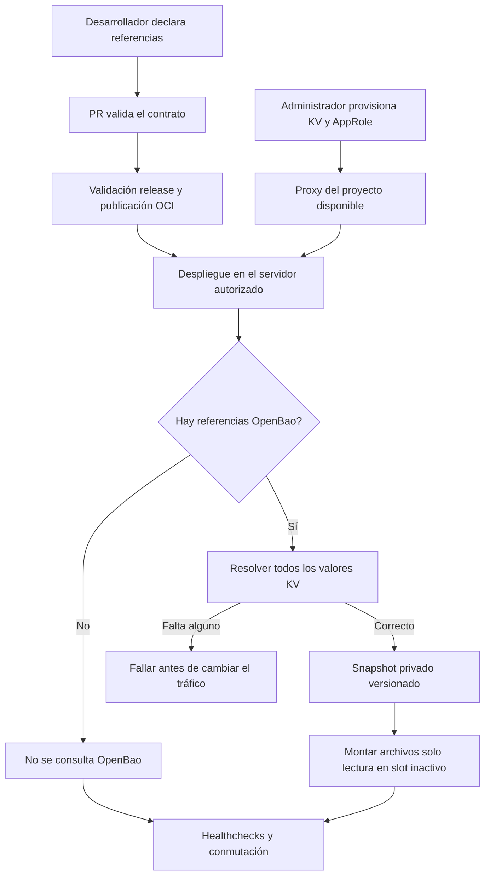

# Ciclo de vida de los secretos

[README principal](../README.md) · [Ciclo de despliegue](README.es.md) · [English](secrets.md) · **Español**

El ciclo de vida de los secretos implementado en **docker-blue-green** distingue **dos mecanismos independientes**: los secrets del repositorio GitHub Actions autentican operaciones CI/CD mediante SSH y OCI; las referencias **OpenBao KV v2**, opcionales, entregan credenciales a la aplicación en ejecución.

**OpenBao no es obligatorio** para inicializar, validar, publicar o desplegar una aplicación. Solo se activa cuando el proyecto declara referencias en `deploy/bluegreen.yml`.

## Responsabilidades

| Operación | Desarrollador | GitHub Actions | Administrador del servidor / OpenBao |
| --- | --- | --- | --- |
| Integrar la aplicación | `bluegreen init`, `bluegreen configure` | Valida el contrato generado | Prepara el host Docker por separado |
| Incorporar un secreto | Declara referencias mediante `bluegreen secrets add` | Comprueba referencias sin valores | Provisiona valores KV y AppRole restringido |
| Configurar OpenBao | No necesita credenciales del host | No configura el proxy | Ejecuta `sudo bluegreen secrets setup` |
| Comprobar requisitos | `bluegreen secrets plan` | Comprueba presencia de secrets GitHub | `bluegreen secrets check` comprueba KV real mediante el proxy |
| Entregar credenciales | La aplicación lee `/run/secrets/<nombre>` | Nunca recibe valores OpenBao | El motor monta archivos versionados de solo lectura |
| Rotación / rollback | No copia credenciales a mano | No modifica KV | Actualiza KV; el reconciliador gestiona versiones |

**No hay que ejecutar todos los comandos.** Solo los que correspondan al escenario. `list` y `fields` son comandos de descubrimiento opcionales.

## 1. Integración normal: sin OpenBao

Desde el repositorio de una aplicación:

```bash
bluegreen init
bluegreen configure
bluegreen config check
bluegreen secrets plan
```

Por ejemplo, el contrato `deploy/bluegreen.yml` puede comenzar así:

```yaml
version: 1
project: miapi
registry:
  host: ghcr.io
  repository: empresa/miapi
  username: empresa
```

**No existe sección `openbao:`.** El motor no consulta el socket de OpenBao, no instala un proxy ni prepara snapshots de secretos. Sigue funcionando `blue-green`, la publicación OCI y el despliegue Blue/Green. Si se habilita el despliegue remoto, se comprueban los secrets **de GitHub** de forma independiente.

Una aplicación que utilice otro mecanismo de credenciales debe gestionarlo expresamente. El motor no cambia silenciosamente a otro almacén ni inyecta valores no declarados.

## 2. Desarrollador: incorporar una referencia opcional

Supongamos que el servicio `api` necesita una clave del proveedor llamada `provider_api_key` dentro del contenedor.

Desde el **equipo de desarrollo**, después de inicializar y configurar el proyecto:

```bash
bluegreen secrets add \
  --dir . \
  --project miapi \
  --mount kv \
  --service api \
  --name provider_api_key \
  --path integrations/provider \
  --field api_key
```

Con `--path` y `--field` se registra la referencia **sin conectarse al proxy** del servidor. Solo se incorporan nombres, nunca valores, a `deploy/bluegreen.yml`:

```yaml
openbao:
  mount: kv
  secrets:
    - service: api
      name: provider_api_key
      path: integrations/provider
      field: api_key
```

La ruta completa de la API KV v2 es `kv/data/projects/miapi/integrations/provider` y el campo se llama `api_key`. El CLI incorpora el prefijo del proyecto: no se incluye `projects/miapi` en `--path`.

Comprobaciones locales antes de registrar el cambio en Git:

```bash
bluegreen config check
bluegreen secrets plan
```

La PR comprueba la estructura y el servicio destino. **No confirma** que la clave esté provisionada en OpenBao ni que funcione contra el proveedor.

### Descubrimiento interactivo opcional

En el **servidor de despliegue**, cuando el proxy está configurado y el contrato del proyecto está disponible:

```bash
bluegreen secrets list --dir . --project miapi --mount kv
bluegreen secrets fields --dir . --project miapi --mount kv --path integrations/provider
```

Estos comandos enumeran rutas autorizadas y **nombres de campos**, no valores. También se puede ejecutar `bluegreen secrets add` sin `--path` ni `--field` desde ese servidor para seleccionar interactívamente. Son operaciones innecesarias si el desarrollador ya conoce la ruta y el campo.

## 3. Administrador: provisionar KV, AppRole y el proxy

Esta etapa corresponde al **administrador del servidor**, no al equipo de desarrollo ni a GitHub Actions.

Antes del comando `setup`, el administrador debe:

1. Disponer de un servidor **OpenBao HTTPS** con KV v2 montado en `kv` y crear el valor del campo `api_key` bajo `projects/miapi/integrations/provider`.
2. Crear una identidad AppRole con permisos restringidos al proyecto. Ejemplo de política:

   ```hcl
   path "kv/data/projects/miapi/*" {
     capabilities = ["read"]
   }
   path "kv/metadata/projects/miapi" {
     capabilities = ["list"]
   }
   path "kv/metadata/projects/miapi/*" {
     capabilities = ["list"]
   }
   ```

3. Guardar RoleID y SecretID en **archivos regulares protegidos** del servidor Linux. Preparar el usuario de despliegue, systemd y `bao` con capacidad de proxy.

En el **servidor**:

```bash
sudo bluegreen secrets setup --project miapi
```

El CLI solicita la URL de origen **HTTPS** de OpenBao, el usuario de despliegue y las **rutas** de los archivos de RoleID y SecretID. Nunca recibe los valores por argumento ni los registra en Git.

El comando instala un proxy gestionado por systemd y un temporizador de reconciliación exclusivos del proyecto. El socket es `/run/bluegreen/miapi/openbao.sock`. **No crea** el servidor OpenBao, los valores KV, la política ni el AppRole.

Con el contrato del proyecto disponible en el directorio de trabajo del despliegue:

```bash
bluegreen secrets check --dir . --project miapi
```

Esta comprobación valida mediante el socket los valores **reales** de todas las referencias, sin imprimirlos. Falla si falta algún dato, la política no permite acceder o el proxy no está disponible.

## 4. Los secrets de GitHub son diferentes

Si se habilita el **despliegue remoto SSH**, el job `repository-secrets` exige estos secrets **del repositorio GitHub**, configurados en *Settings → Secrets and variables → Actions*:

| Secret | Finalidad |
| --- | --- |
| `SERVER_SSH_PRIVATE_KEY` | Autenticación SSH del despliegue |
| `OCI_REGISTRY_PULL_USERNAME` | Usuario lector del registro OCI |
| `OCI_REGISTRY_PULL_TOKEN` | Token lector del registro OCI |

GitHub suministra automáticamente `GITHUB_TOKEN` para publicar en GHCR; no se crea manualmente. Si el despliegue remoto está desactivado, el check generado no exige esas tres credenciales SSH/OCI.

GitHub evalúa **booleanos de presencia** sin entregar los valores al runner de validación. Esto no demuestra que las credenciales funcionen, que haya acceso al servidor ni que existan secretos KV. Para bloquear la fusión, el repositorio debe marcar `blue-green` como check obligatorio en sus reglas de protección de rama.

## 5. Entrega de los secretos al desplegar



Para cada referencia, el motor genera un Compose complementario y monta en el servicio correspondiente un archivo de solo lectura:

```text
/run/secrets/provider_api_key
```

La aplicación debe leer ese archivo. Por ejemplo, una API Go puede utilizar `os.ReadFile("/run/secrets/provider_api_key")` y entregar el valor a su cliente HTTP sin registrarlo en logs. El motor **no lo convierte** en variable de entorno ni lo incrusta en la imagen o en los artefactos de GitHub Actions.

Los snapshots quedan en el **host Docker**, bajo `.bluegreen/secrets/`, para permitir reinicios y rollback. Es necesario proteger el almacenamiento del servidor. Ni el socket ni los datos del AppRole se montan en los contenedores.

## 6. Rotación, reconciliación y rollback

Un temporizador systemd específico del proyecto comprueba versiones KV v2 **cada cinco minutos**. Cuando cambia un secreto necesario, el motor puede preparar el slot inactivo con **las mismas imágenes inmutables**, montar el nuevo snapshot, verificar healthchecks y conmutar el tráfico. **No publica ni despliega automáticamente la última imagen OCI disponible.**

El slot anterior conserva su snapshot para rollback. Después de ejecutar `bluegreen rollback` explícitamente, la reconciliación automática queda suspendida hasta un nuevo despliegue manual correcto.

El rollback no deshace migraciones de base de datos, efectos externos ni revoca claves en proveedores. La revocación o rotación de emergencia sigue siendo responsabilidad administrativa.

## 7. Límites de las comprobaciones

| Comprobación | Valida | No valida |
| --- | --- | --- |
| `bluegreen secrets plan` | Requisitos declarados y referencias sin valores | Disponibilidad real en GitHub u OpenBao |
| Job `repository-secrets` | Presencia de los secrets GitHub exigidos | Autenticación SSH/OCI o acceso a KV |
| Validación reutilizable `blue-green` | Archivos, Compose, servicios y estructura de referencias | Arranque de contenedores u OpenBao productivo |
| `bluegreen secrets check` en servidor | Resolución de valores KV reales por el proxy | Función de la aplicación o autorización del proveedor |
| Despliegue real | Montajes, hooks y healthchecks antes de conmutar | Reversibilidad de migraciones o efectos externos |

Referencias: [ciclo de despliegue](README.es.md), [README principal](../README.md), [proxy OpenBao](../internal/openbao/provision.go), [entrega de secretos](../internal/deploy/secrets.go) y [pruebas de integración OpenBao](../.github/workflows/test-openbao.yml).
