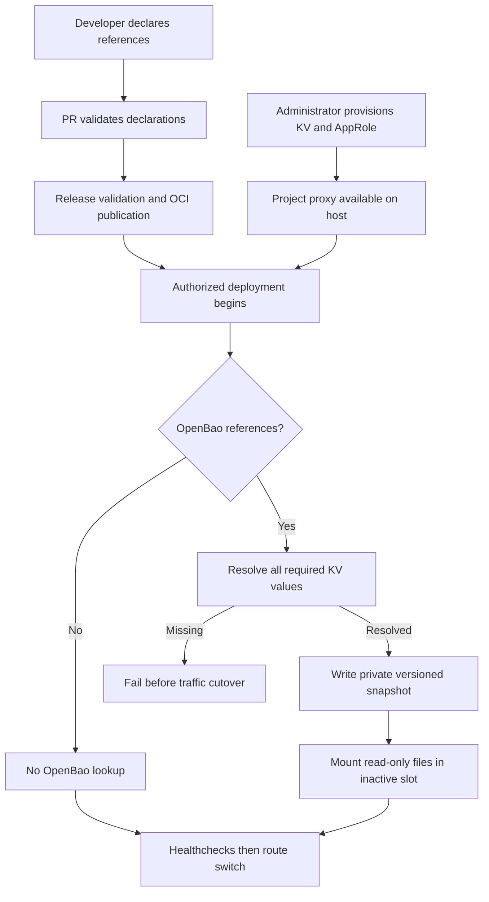

# Secrets lifecycle

[Main README](../README.md) · [Deployment lifecycle](README.md) · **English** · [Español](secrets.es.md)

The implemented secrets lifecycle has **two independent concerns**: GitHub Actions repository secrets authenticate CI/CD access to SSH and OCI; optional OpenBao KV v2 references provide application credentials at runtime. OpenBao is **not required** to initialize, validate, publish or deploy an application. It becomes active only when the project declares secret references in `deploy/bluegreen.yml`.

## Who does what?

| Activity | Developer | GitHub Actions | Server / OpenBao administrator |
| --- | --- | --- | --- |
| Integrate the application | `bluegreen init`, `bluegreen configure` | Validates generated contract | Prepares Docker host independently |
| Add application credentials | Declares `bluegreen secrets add` references | Validates references without values | Creates KV values and scoped AppRole |
| Configure OpenBao | No host credentials required | Never configures the proxy | Runs `sudo bluegreen secrets setup` |
| Check readiness | `bluegreen secrets plan` | Checks configured GitHub repository secret presence | Runs `bluegreen secrets check` against the project proxy |
| Consume credentials | Reads `/run/secrets/<name>` in the application | Never receives OpenBao values | Engine resolves values and mounts read-only files |
| Rotate / roll back | Does not manually copy values | Does not rotate KV | Updates KV; host reconciliation handles versions |

Only execute the commands relevant to your project. In particular, `list` and `fields` are optional discovery operations.

## 1. Start without OpenBao

In an existing application repository:

```bash
bluegreen init
bluegreen configure
bluegreen config check
bluegreen secrets plan
```

An example `deploy/bluegreen.yml` contains **no `openbao:` section**:

```yaml
version: 1
project: myapi
registry:
  host: ghcr.io
  repository: company/myapi
  username: company
```

No proxy connection or OpenBao secret snapshot is attempted. The generated `blue-green` workflow still validates the application contract. If SSH deployment is configured, the required **GitHub** secrets are checked independently. A project using another credential mechanism must arrange its delivery explicitly; the engine does not silently substitute a different secrets backend.

## 2. Developer: opt in with a reference

Suppose service `api` needs a provider API key. From the developer workstation, after the project has been initialized and configured:

```bash
bluegreen secrets add \
  --dir . \
  --project myapi \
  --mount kv \
  --service api \
  --name provider_api_key \
  --path integrations/provider \
  --field api_key
```

Providing both `--path` and `--field` makes this operation **offline**: it does not require the server-side proxy. The CLI appends **references, never secret values**:

```yaml
openbao:
  mount: kv
  secrets:
    - service: api
      name: provider_api_key
      path: integrations/provider
      field: api_key
```

For this project the actual KV v2 API path is `kv/data/projects/myapi/integrations/provider`. The project prefix is automatically applied by the CLI, so do **not** include `projects/myapi` in `--path`.

Check and commit the declaration:

```bash
bluegreen config check
bluegreen secrets plan
```

The pull-request workflow verifies the service target and reference structure. It **does not** access the real OpenBao value or prove that the provider accepts it.

### Optional interactive discovery on the host

Once the proxy is configured and the project contract is available on the **deployment host**, use:

```bash
bluegreen secrets list --dir . --project myapi --mount kv
bluegreen secrets fields --dir . --project myapi --mount kv --path integrations/provider
```

These commands reveal authorized paths and field **names**, not values. Running `bluegreen secrets add` without `--path` and `--field` at that host also provides a guided selection. These operations are unnecessary when the developer already knows the reference.

## 3. Administrator: provision the real secret and project proxy

This is **not a developer workstation or pull-request job**. Before running the setup command, the server administrator must:

1. Provide an existing **HTTPS OpenBao server** with KV v2 mount `kv` and store the `api_key` field at `projects/myapi/integrations/provider`.
2. Create a project-scoped AppRole with a policy permitting only the required KV paths. For example:

   ```hcl
   path "kv/data/projects/myapi/*" {
     capabilities = ["read"]
   }
   path "kv/metadata/projects/myapi" {
     capabilities = ["list"]
   }
   path "kv/metadata/projects/myapi/*" {
     capabilities = ["list"]
   }
   ```

3. Prepare protected **regular files** containing RoleID and SecretID on the Linux deployment host, and ensure the deployment user, systemd and the `bao` binary with proxy support exist.

On the deployment server:

```bash
sudo bluegreen secrets setup --project myapi
```

The CLI prompts for the HTTPS OpenBao **origin URL**, Linux deployment account and **paths** to the existing RoleID/SecretID files. It does **not** prompt for or print their values. Setup installs one isolated systemd-managed proxy and reconciliation timer for the project; its socket is `/run/bluegreen/myapi/openbao.sock`. It does not create the OpenBao server, KV values, AppRole or policy.

When the project's deployment contract is available in the server working directory:

```bash
bluegreen secrets check --dir . --project myapi
```

This validates access to **real** referenced values through the project socket without printing them. A missing value, denied policy, unavailable proxy or invalid reference causes failure.

## 4. GitHub secrets are different from OpenBao secrets

If the project enables **remote SSH deployment**, the generated `repository-secrets` job requires these GitHub Actions repository secrets under *Settings → Secrets and variables → Actions*:

| Secret | Purpose |
| --- | --- |
| `SERVER_SSH_PRIVATE_KEY` | SSH authentication for deployment |
| `OCI_REGISTRY_PULL_USERNAME` | OCI registry reader identity |
| `OCI_REGISTRY_PULL_TOKEN` | OCI registry read token |

GitHub supplies `GITHUB_TOKEN` automatically for GHCR publication; it is not a manually provisioned repository secret. When remote deployment is disabled, the generated gate does not require the three SSH/OCI secrets.

GitHub evaluates **presence-only Boolean expressions**, never exposing secret values to the validation runner. It cannot establish credential correctness, access to the deployment server or availability of OpenBao KV values. To prevent merging, the project repository must configure the `blue-green` check as required in GitHub branch rules.

## 5. What happens during deployment?



For each declared application secret the engine builds a Compose override that mounts a read-only file in the designated service:

```text
/run/secrets/provider_api_key
```

The application must read this file. For example, Go code can use `os.ReadFile("/run/secrets/provider_api_key")` and pass the result to its provider client without logging it. The engine does **not** inject secret values into environment variables, images or GitHub Actions.

Versioned snapshots are persisted on the **Docker host** beneath `.bluegreen/secrets/` to preserve restart and rollback behavior. Protect host access and storage. Proxy socket and AppRole credentials are **not** mounted into the application containers.

## 6. Rotation and rollback

The project-specific systemd timer checks KV v2 versions **every five minutes**. When a required secret version changes, the engine can prepare the inactive slot with the **same pinned application images**, mount the new snapshot, verify health and switch traffic. It does not deploy a new OCI release automatically.

The previous slot retains its previous snapshot for rollback. After an explicit `bluegreen rollback`, automatic secret reconciliation is paused until the next manually initiated successful deployment, preventing immediate reapplication of the version that was rolled back.

A route/secret rollback does **not** reverse database migrations, external side effects or revoke credentials at the external provider. Incident-driven credential revocation remains an administrator responsibility.

## 7. Validation boundaries

| Check | What it proves | What it does not prove |
| --- | --- | --- |
| `bluegreen secrets plan` | Declared requirements and OpenBao references, without accessing values | Existence of GitHub credentials or KV values |
| `repository-secrets` CI job | Required GitHub repository secrets are present | Credentials actually work or OpenBao is reachable |
| Reusable `blue-green` validation | Files, services, Compose and reference structure | Running container health or production OpenBao readiness |
| `bluegreen secrets check` on host | Real referenced KV values can be resolved through project proxy | Application functionality or provider access |
| Actual deployment | Mounted values, lifecycle and healthchecks before routing | Reversibility of database migrations or external effects |

Related documentation: [deployment lifecycle](README.md), [main README](../README.md), [OpenBao proxy](../internal/openbao/provision.go), [secret delivery](../internal/deploy/secrets.go), [OpenBao integration tests](../.github/workflows/test-openbao.yml).
